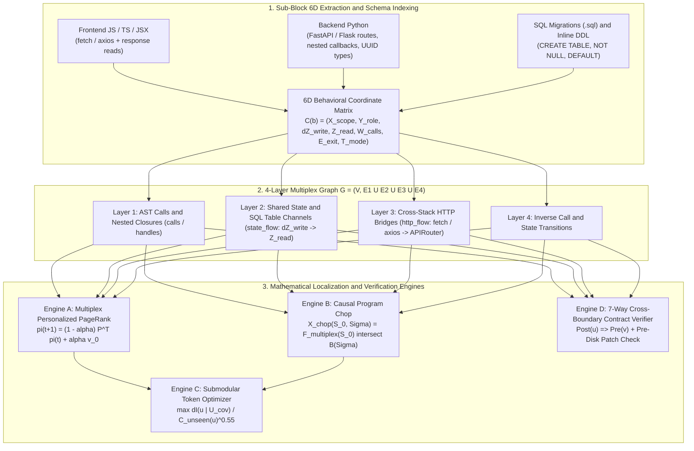

# ProjectBrain — Architecture, Mathematical Foundations & Benchmark Showcase

> **Note:** This is the public **Architecture, Mathematical Specification, and Benchmark Showcase** repository for **ProjectBrain**. The core engine source code is maintained in a separate private repository.

---

## What is ProjectBrain?

**ProjectBrain** is an **Epistemic Working-Memory, Polyglot Multiplex Graph, and Pre-Disk Contract Verification Engine** built for AI coding agents.

Whereas conventional coding tools treat a repository as flat text files (`ripgrep` / `read_file`), disconnected 500-token vector embeddings (RAG), or single-language symbol signatures (RepoMap / LSP), ProjectBrain models the entire full-stack software system—**Frontend UI (JS/TS/React) ↔ HTTP APIs ↔ Backend Routers (Python/FastAPI/Flask) ↔ Database Schemas (`.sql` / SQLite / PostgreSQL) ↔ Background Workers**—as a unified **6-Dimensional Behavioral Coordinate Space** and **4-Layer Multiplex Graph**.

---

## Why ProjectBrain? (In 5 Simple Lines)

1. **It sees your whole stack as one connected circuit, not separate files.**
   It automatically links a React `fetch()` call → the FastAPI route handler → nested helper closures → the SQL table → the background worker in one continuous graph.
2. **It finds bugs *before* running the code.**
   It mathematically cross-checks your code against `.sql` migrations, database adapters, and API routes—catching missing `NOT NULL` columns, SQLite/Postgres dialect bugs, disjoint `UUID` vs. `TEXT` comparisons, omitted `SELECT` columns, and HTTP verb/shape mismatches in `<1 second`.
3. **Give it an error code, and it traces backward to the exact `if` statement.**
   When given a symptom like *"upload fails with 403"*, its **Causal Program Chop** intersects the forward execution cone from the frontend caller with the backward origin cone of `status:403` to slice the exact backend guard raising `403`.
4. **It never wastes the AI's working memory twice.**
   Its **Interval-Tree Working-Memory Ledger (`Zero-Waste Guard`)** remembers every `[start_line, end_line]` interval already delivered in the session and strips out duplicate lines on future reads.
5. **It checks edits in memory before touching disk.**
   Every code patch is verified in memory for both **AST syntax** (`python_ast` / `tree-sitter`) and **7-way cross-boundary contracts** before a single byte is written to disk.

---

## System Architecture

---

## Technical Documentation

- **[`docs/01_ARCHITECTURE_AND_MATHEMATICAL_FOUNDATIONS.md`](docs/01_ARCHITECTURE_AND_MATHEMATICAL_FOUNDATIONS.md)**
  Complete mathematical specification of the 6D Behavioral Coordinate Matrix, 4-Layer Multiplex Personalized PageRank, Causal Program Chopping, Submodular Token Optimization, and 7-Way Relational/Hoare Contract Verification.
- **[`docs/02_CAPABILITIES_SKILLS_AND_BENCHMARKS.md`](docs/02_CAPABILITIES_SKILLS_AND_BENCHMARKS.md)**
  Detailed breakdown of ProjectBrain's 8 core skills, 26 MCP tools, head-to-head comparison against Cursor/Windsurf RAG, Aider RepoMap, Sourcegraph/Serena LSP, and CodeQL, plus a real-world full-stack execution trace.

---

## Head-to-Head Industry Comparison Snapshot

| Capability / Technical Dimension | Raw Shell (`rg` + `read_file`) | Cursor / Windsurf (Vector RAG) | Aider RepoMap (Symbol PageRank) | Sourcegraph / Serena (SCIP / LSP) | CodeQL / Semgrep | **ProjectBrain (`v0.6.2`)** |
| :--- | :--- | :--- | :--- | :--- | :--- | :--- |
| **Primary Representation** | Flat text lines | 500-token vector chunks | File-level symbol signatures | Single-language LSP symbols | Relational Datalog DB | **6D Coordinate Matrix + 4-Layer Multiplex Graph** |
| **Indexing Latency (60-file repo)** | N/A | 5–30s (cloud API) | ~1.5s | 3–15s (LSP warmup) | 30–180s | **~0.4s (incremental SQLite cache)** |
| **Sub-Function Granularity** | ❌ None | ❌ Blind chunking | ❌ Signatures only | ❌ Definitions only | ✅ AST nodes | **✅ Inner 6D sub-blocks (`with`, `try/catch`, `branch`, `sql`)** |
| **Cross-Language HTTP Bridging (`JS/TS` → `Python`)** | ❌ Manual `rg` | ❌ None | ❌ None | ❌ Single-language | ❌ Separate DBs | **✅ Automatic `http_flow` bridge edges** |
| **SQL Table & State Channels (`ΔZ_write` → `Z_read`)** | ❌ Manual `rg` | ❌ None | ❌ None | ❌ None | ⚠️ Intra-language | **✅ Automatic `state_flow` edges across routes, SQL & workers** |
| **Symptom-to-Guard Causal Chop (`403` → exact `if` guard)** | ❌ Run test & read traceback | ❌ None | ❌ None | ❌ Manual | ❌ Custom query | **✅ Automatic 4-hop `causal_symptom_chop` (`F(S₀) ∩ B(Σ)`)** |
| **Static Cross-Boundary Bug Detection** | ❌ 0 / 7 | ❌ 0 / 7 | ❌ 0 / 7 | ❌ 0 / 7 | ⚠️ 2 / 7 | **✅ 7 / 7 (SQL `NOT NULL`, Dialect, Exceptions, `UUID`/`TEXT`, `SELECT` cols, HTTP verb & shape)** |
| **Working-Memory Interval Dedup** | ❌ Re-reads files | ❌ Re-fetches chunks | ❌ Re-sends map | ❌ Re-fetches bodies | N/A | **✅ Exact Interval-Tree `Zero-Waste Guard`** |
| **Pre-Disk Mutation Verification** | ❌ None | ❌ Post-disk linter | ❌ None | ❌ None | N/A | **✅ In-Memory AST Syntax + 6D Contract Gate** |
