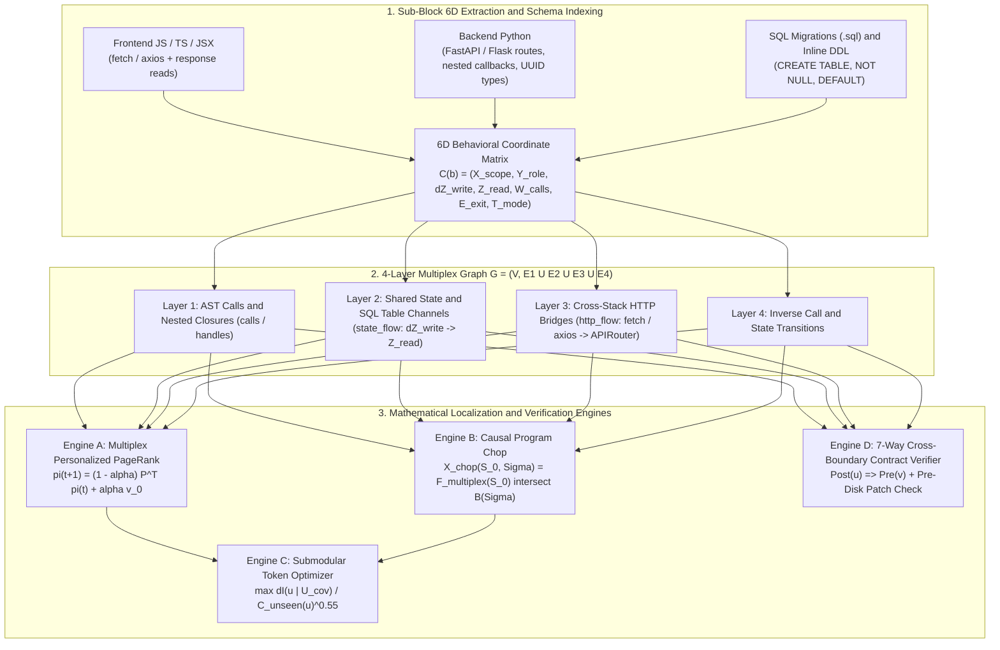

# ProjectBrain: Polyglot 6D Multiplex Graph & Mathematical Foundations

> [!IMPORTANT]
> **Architectural Thesis:** ProjectBrain transforms code retrieval from passive lexical/vector lookup into a **polyglot, cross-stack mathematical reasoning & static verification engine** that bridges **Frontend (JS/TS/React) ↔ Backend (Python/FastAPI/Flask) ↔ Database Schemas (`.sql` / SQLite / PostgreSQL) ↔ Background Workers** in `<1 second`.

---

## 1. End-to-End Pipeline Diagram

---

## 2. The 5 Core Mathematical Engines

### Engine 1: Fine-Grained 6D Behavioral Coordinate Matrix & SQL Schema Algebra

Every function (`>= 8` lines) in Python, TypeScript, or JavaScript is decomposed into inner structural sub-blocks (`with[...]`, `try_block`, `catch[...]`, `branch[...]`, `sql[...]`, `useEffect[...]`, `case ...`). Each sub-block `b` is mapped to a 6D coordinate vector plus formal I/O contracts:

$$
C(b) = \left( X_{\text{scope}},\; Y_{\text{role}},\; \Delta Z_{\text{write}},\; Z_{\text{read}},\; W_{\text{calls}},\; E_{\text{exit}},\; T_{\text{mode}} \right)
$$

- **Exit Contract Lattice (`E_exit`):** Captures exceptions (`throw:ApiError`, `catch:IntegrityError`), HTTP status codes (`status:403`, `status:404`, `status:422`), semantic error tags (`err:forbidden`), and guard returns (`guard_return`).
- **Relational Schema Evolution & Lexical Scope Algebra (`S(T)`):** Parses `.sql` migration files and inline `CREATE TABLE` blocks into column sets `Cols(T)` and strict required column sets `Req(T)`, folds chronological `ALTER TABLE` operations (`DROP NOT NULL`, `SET NOT NULL`, `SET DEFAULT`, `ADD/DROP COLUMN`) across sorted migrations, and binds local `INSERT INTO T` statements to module-local `CREATE TABLE T` definitions before falling back to global schemas:

$$
\text{Req}^{(k)}(T) = \Big(\text{Req}^{(k-1)}(T) \cup \Delta_{\text{SET\_NOT\_NULL}}^{(k)}(T)\Big) \setminus \Big(\Delta_{\text{DROP\_NOT\_NULL}}^{(k)}(T) \cup \Delta_{\text{SET\_DEFAULT}}^{(k)}(T)\Big)
$$

---

### Engine 2: 4-Layer Multiplex Graph & Personalized PageRank (`multiplex_ppr`)

Unifies four distinct graph layers into a single column-stochastic Markov transition operator `P_multiplex`:

1. **`http_flow` (`w_fwd = 1.40`):** Normalizes frontend `fetch`/`axios` URL templates (`/api/v1/batches/${batchId}/files` → `/api/v1/batches/{*}/files`) and matches them against backend route decorators combined with `APIRouter(prefix=...)` / `Blueprint(url_prefix=...)`.
2. **`state_flow` (`w_fwd = 1.20`):** Connects any function mutating a SQL table or state key (`k ∈ ΔZ_write(u)`) to any function reading it (`k ∈ Z_read(v)`).
3. **`handles` & `calls` (`w_fwd = 1.10, 1.00`):** Direct AST calls, route handlers, and lexically nested callback functions (`on_file_headers` inside `upload_file`).
4. **Inverse edges (`w_bwd ∈ [0.65, 0.85]`):** Backward edges across all layers.

Starting from query seed vector `v_0`, `multiplex_ppr` runs `T = 12` power iterations with restart probability `alpha = 0.30`:

$$
\pi^{(t+1)} = (1 - \alpha)\, P_{\text{multiplex}}^{\top}\, \pi^{(t)} + \alpha\, v_0
$$

---

### Engine 3: Causal Program Chop across the Multiplex Graph (`causal_symptom_chop`)

When a prompt mentions an error symptom `Σ` (e.g., `403`, `forbidden`, `404`, `409`, `422`), ProjectBrain computes the **Causal Program Chop**—the intersection of the 4-hop forward multiplex execution cone from entry seeds `S_0` and the set of nodes whose local exit contracts emit `Σ`:

$$
X_{\text{chop}}(S_0, \Sigma) = F_{\text{multiplex}}^{\le 4}(S_0) \;\cap\; \left\{\, v \in V \;\middle|\; E_{\text{exit}}^{\text{local}}(v) \cap \Sigma \neq \emptyset \,\right\}
$$

It reconstructs the exact cross-stack causal chain (`s_0 —[http_flow]→ u_1 —[calls]→ ... —[calls]→ v*`) and slices the exact guard in `v*` into the dossier.

---

### Engine 4: Submodular Marginal Information Gain-per-Token Optimizer

Given candidate slices `C_rem`, already-covered 6D behavioral features `U_cov`, and exact unseen line token cost `C_unseen(u)` from the Interval-Tree Working-Memory Ledger, the dossier greedily selects at each step:

$$
u^* = \arg\max_{u \in C_{\text{rem}}} \frac{\pi_{\text{PPR}}(u) \cdot \left( 1 + \sum_{f \in F(u) \setminus U_{\text{cov}}} \omega_f \right)}{\left( \max(12,\, C_{\text{unseen}}(u)) \right)^{0.55}}
$$

---

### Engine 5: 7-Way Cross-Boundary Contract Verifier & Pre-Disk Patch Verification

Pass C checks **7 formal invariants** statically during `dossier` compilation AND in memory during `projectbrain patch` (even in `apply=False` dry-run mode before touching disk):

| # | Diagnostic Tag | Mathematical Invariant Checked | Bug Class Caught Statically |
| :--- | :--- | :--- | :--- |
| **1** | `[6D Schema Contract Violation]` | `Req^(k)(T) \ Cols_INSERT(q) = ∅` | `INSERT INTO` omitting `NOT NULL` columns lacking `DEFAULT` after chronological `ALTER TABLE` folding & lexical scope resolution |
| **2** | `[6D SQL Dialect Mismatch]` | `Φ_query(q) ⊆ Φ_adapter(SQLite)` | PostgreSQL `interval '...'`, `make_interval`, `= ANY(%s)` against untranslated `sqlite3` |
| **3** | `[6D Exception Contract Mismatch]` | `ΔZ_write ≠ ∅ ⟹ catch:IntegrityError ∈ E_exit` | Catching `psycopg.UniqueViolation` without `sqlite3.IntegrityError` |
| **4** | `[6D Type Disjointness Violation]` | `τ(e_1) ∩ τ(e_2) = ∅` (via Python `ast` dataflow) | Intra-procedural AST dataflow tracking parameter/variable types & row aliases (`owner = row["col"]`) across disjoint comparisons (`UUID` vs `TEXT`, `int` vs `str`) |
| **5** | `[6D Producer-Consumer SQL Shape Violation]` | `Post(SELECT) ⊨ Pre(row[k])` | Reading `row["col"]` when `col` was omitted from `SELECT c1, c2 FROM T` |
| **6** | `[6D HTTP Route Method Mismatch]` | `Method_FE(u) ∈ Methods_BE(url)` | Frontend `fetch`/`axios` calling `DELETE`/`PUT` on a `POST`-only backend route (including `${API_BASE}/...` prefixes) |
| **7** | `[6D Cross-Stack HTTP Shape Violation]` | `Post_BE(v) ⊨ Pre_FE(u)` | Frontend reading `data.prop` when backend handler's AST `return {...}` (including nested dicts & Pydantic/dataclass models) omits `prop` |
